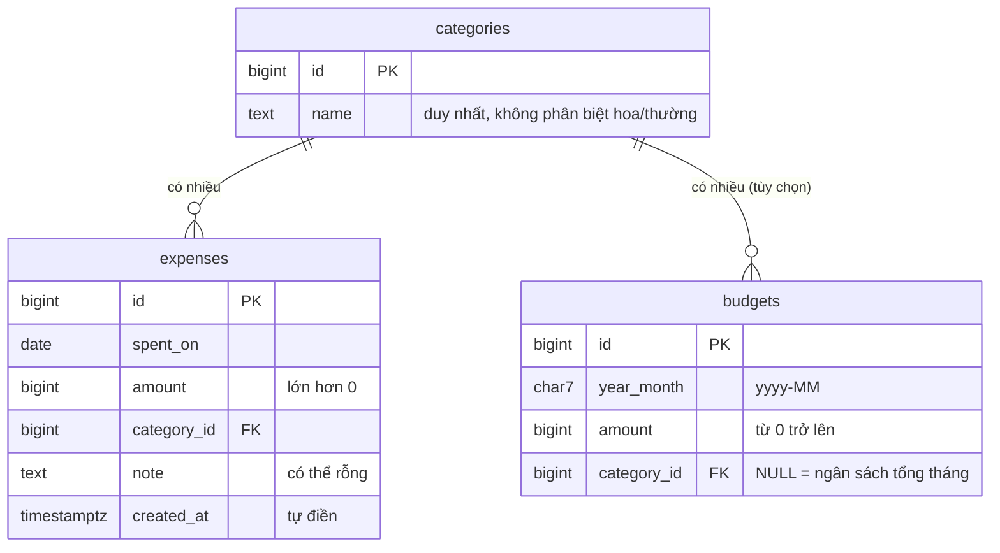

# Thiết kế cơ sở dữ liệu (PostgreSQL trên Supabase)

> Cập nhật 09/10/2026: đổi từ bản nháp SQL Server sang **PostgreSQL** theo quyết định dùng Supabase của nhóm.
> Cập nhật 19/10/2026: tên bảng và cột đổi theo `supabase/schema.sql` của Dev A đang chạy trên Supabase (`categories`, `expenses`, `spent_on`); BA chỉ thêm bảng `budgets`.
> File tạo bảng: `db/schema.sql`. Dữ liệu mẫu: `db/seed.sql`. Cả hai đã chạy thử trên PostgreSQL 16 (cục bộ); xem kết quả trong `test-cases.md`.

## 1. Sơ đồ quan hệ (ERD)




## 2. Từ điển dữ liệu

### Bảng `categories` (danh mục)
| Cột | Kiểu | Bắt buộc | Ràng buộc | Ý nghĩa |
|---|---|---|---|---|
| id | bigint (identity) | Có | Khóa chính, tự tăng | Mã danh mục |
| name | text | Có | Không rỗng; duy nhất (Dev A) và duy nhất theo `lower(btrim(name))` (BA bổ sung) | Tên danh mục |

### Bảng `expenses` (khoản chi)
| Cột | Kiểu | Bắt buộc | Ràng buộc | Ý nghĩa |
|---|---|---|---|---|
| id | bigint (identity) | Có | Khóa chính, tự tăng | Mã khoản chi |
| spent_on | date | Có | — | Ngày chi |
| amount | bigint | Có | Lớn hơn 0 | Số tiền (đồng) |
| category_id | bigint | Có | Khóa ngoại → `categories(id)` (không cho xóa danh mục đang có khoản chi) | Danh mục |
| note | text | Không | — | Ghi chú |
| created_at | timestamptz | Có | Mặc định `now()` | Thời điểm tạo dòng |

Chỉ mục: `expenses_spent_on_idx (spent_on)`, `expenses_category_idx (category_id)`.

### Bảng `budgets` (ngân sách tháng, BA thêm, trang web chưa dùng)
| Cột | Kiểu | Bắt buộc | Ràng buộc | Ý nghĩa |
|---|---|---|---|---|
| id | bigint (identity) | Có | Khóa chính, tự tăng | Mã ngân sách |
| year_month | char(7) | Có | Đúng dạng `yyyy-MM`, tháng 01 đến 12 | Tháng áp dụng |
| amount | bigint | Có | Từ 0 trở lên | Hạn mức (đồng) |
| category_id | bigint | Không | Khóa ngoại → `categories(id)`, `ON DELETE CASCADE` | `NULL` = ngân sách tổng cả tháng |

Chỉ mục duy nhất: mỗi `(year_month, category_id)` một dòng; mỗi `year_month` chỉ một dòng có `category_id` rỗng.

## 3. Tương ứng với mã nguồn
| Mã nguồn (Dev A, Dev B) | Cột CSDL |
|---|---|
| `Expense.id` | `expenses.id` |
| `Expense.date` | `expenses.spent_on` |
| `Expense.amount` | `expenses.amount` |
| `Expense.categoryId` | `expenses.category_id` |
| `Expense.note` | `expenses.note` |

PostgreSQL quy ước tên viết thường, nối bằng dấu gạch dưới. Nếu dùng thư viện truy cập dữ liệu tự đổi `categoryId` ↔ `category_id` thì không cần sửa gì thêm; nếu không, cần ánh xạ tên cột bằng tay.

## 4. Cách tạo bảng trên Supabase
1. Vào Supabase, mở dự án của nhóm, chọn **SQL Editor**, bấm **New query**.
2. Dán toàn bộ nội dung `db/schema.sql`, bấm **Run**. Thấy "Success. No rows returned".
3. Tạo query mới, dán `db/seed.sql`, bấm **Run** để có dữ liệu mẫu.
4. Mở **Table Editor** để xem 3 bảng `categories`, `expenses`, `budgets`. Với dữ liệu mẫu của BA trên dự án trống: 6, 15 và 3 dòng. Dự án của nhóm đã có dữ liệu mẫu của Dev A (7 danh mục, 24 khoản chi) nên số dòng sẽ khác.

Cả hai file chạy lại nhiều lần không gây lỗi và không nhân đôi dữ liệu mẫu.

## 5. Bảo mật: Row Level Security (RLS)
Supabase cho phép trình duyệt gọi thẳng cơ sở dữ liệu bằng khóa công khai (publishable/`anon`) nằm trong mã web. `schema.sql` bật RLS cho cả 3 bảng. Theo cách Dev A đang dùng, **bản demo cho phép khóa công khai đọc, thêm và xóa** những thao tác trang web cần:

| Bảng | `anon` và `authenticated` được phép |
|---|---|
| `categories` | đọc, thêm (không sửa, không xóa) |
| `expenses` | đọc, thêm, xóa (không sửa) |
| `budgets` | đọc, thêm (BA thêm, web chưa dùng) |

Hệ quả cần ghi vào báo cáo như một **rủi ro đã biết**: ai lấy được khóa công khai (nằm trong `web/config.js`) đều đọc, thêm và xóa được khoản chi. Hướng khắc phục ở bước sau: thêm đăng nhập Supabase Auth rồi đổi các policy từ `anon, authenticated` thành chỉ `authenticated` và lọc theo `auth.uid()`.

Khóa `service_role` (secret) **không bao giờ** được đưa vào mã chạy trên trình duyệt hay commit lên GitHub. Khóa publishable thì được phép công khai.

## 6. Truy vấn mẫu (đã chạy trên dữ liệu mẫu)
Chạy từng câu trong SQL Editor của Supabase. Kết quả mong đợi là kết quả đã kiểm chứng trên PostgreSQL 16.

**Q1. Tổng chi theo tháng**
```sql
select to_char(spent_on, 'YYYY-MM') as thang, sum(amount) as tong_chi, count(*) as so_khoan
from expenses group by 1 order by 1;
```
Mong đợi: `2026-09 | 1615000 | 7` và `2026-10 | 2850000 | 8`.

**Q2. Tổng chi theo danh mục trong tháng 10**
```sql
select c.name, sum(e.amount) as tong
from expenses e join categories c on c.id = e.category_id
where to_char(e.spent_on, 'YYYY-MM') = '2026-10'
group by c.name order by tong desc, c.name;
```
Mong đợi (từ trên xuống): Ăn uống 920000, Mua sắm 900000, Học tập 450000, Hóa đơn 280000, Giải trí 200000, Di chuyển 100000.

**Q3. Danh mục chi nhiều nhất mỗi tháng**
```sql
select distinct on (thang) thang, name, tong from (
  select to_char(e.spent_on, 'YYYY-MM') as thang, c.name, sum(e.amount) as tong
  from expenses e join categories c on c.id = e.category_id group by 1, 2
) t order by thang, tong desc, name;
```
Mong đợi: `2026-09 | Mua sắm | 400000` và `2026-10 | Ăn uống | 920000`.

**Q4. So sánh tháng 10 với tháng 9 (10 trừ 9)**
```sql
select (select coalesce(sum(amount), 0) from expenses where to_char(spent_on, 'YYYY-MM') = '2026-10')
     - (select coalesce(sum(amount), 0) from expenses where to_char(spent_on, 'YYYY-MM') = '2026-09') as chenh_lech;
```
Mong đợi: `1235000`.

**Q5. Ngân sách và mức đã chi của tháng 10**
```sql
select coalesce(c.name, '(Tổng cả tháng)') as pham_vi, b.amount as ngan_sach,
  (select coalesce(sum(e.amount), 0) from expenses e
    where to_char(e.spent_on, 'YYYY-MM') = b.year_month
      and (b.category_id is null or e.category_id = b.category_id)) as da_chi
from budgets b left join categories c on c.id = b.category_id
where b.year_month = '2026-10' order by b.category_id nulls first;
```
Mong đợi: `(Tổng cả tháng) | 3000000 | 2850000` và `Ăn uống | 1000000 | 920000`.

**Q6. Vượt ngân sách**: thêm một khoản chi "Ăn uống" 200.000 vào ngày 2026-10-09 rồi chạy lại Q5, kết quả mong đợi là tổng cả tháng chi 3.050.000 (vượt 3.000.000) và "Ăn uống" chi 1.120.000 (vượt 1.000.000). Sau khi thử, xóa khoản chi vừa thêm (ghi chú "test") để dữ liệu mẫu về như cũ.

## 7. Điểm cần xác nhận với Dev
| # | Nội dung | Mặc định đang dùng | Người quyết |
|---|---|---|---|
| 1 | Ngân sách tổng hay theo danh mục | Hỗ trợ cả hai (`category_id` rỗng là tổng) | Dev B |
| 2 | Kiểu số tiền trong mã nguồn | `numeric(18,0)` nhận `long` và `BigDecimal` | Dev A |
| 3 | Có đăng nhập người dùng cuối không | Chưa; RLS chỉ cho `authenticated` và `service_role` | Cả nhóm |
| 4 | Có cần cột người sở hữu (`user_id`) không | Không có; nếu cần nhiều người dùng thì bổ sung kèm chính sách RLS theo `auth.uid()` | Cả nhóm |

## 7. Số liệu của dữ liệu mẫu Dev A (đang có trên Supabase của nhóm)
`supabase/schema.sql` của Dev A đã nạp sẵn 7 danh mục và 23 khoản chi. BA tính bằng PostgreSQL 16 cục bộ (19/10/2026) để đối chiếu khi test trên trang web:

| Tháng | Số khoản | Tổng chi | Danh mục chi nhiều nhất |
|---|---|---|---|
| 2026-09 | 15 | 4.139.000 | Nhà ở và hóa đơn (2.285.000) |
| 2026-10 | 8 | 2.810.000 | Nhà ở và hóa đơn (1.800.000) |

Chênh lệch tháng 10 so với tháng 9: giảm 1.329.000. Các số ở mục 6 và trong `test-cases.md` thuộc về `db/seed.sql` của BA (chạy trên dự án trống), nên **không** dùng để đối chiếu với trang web thật.

## 8. Bảng và hàm cho tính năng gia đình (bổ sung 27/10/2026)
Nguồn: `supabase/family-1-bang.sql` (Dev A). Đã chạy trên PostgreSQL 16 cục bộ với `auth.users` và `auth.uid()` giả lập, chạy hai lần không lỗi. Chưa chạy trên Supabase thật.

| Bảng | Cột chính | Ghi chú |
|---|---|---|
| `profiles` | `id` (= `auth.users.id`), `full_name` | tạo tự động bởi trigger `on_auth_user_created` |
| `families` | `id` uuid, `name`, `invite_code` (8 ký tự, duy nhất), `created_by` | |
| `family_members` | `user_id` (khóa chính), `family_id`, `role` (`admin` hoặc `member`) | mỗi người một gia đình |
| `incomes` | `id`, `user_id`, `received_on`, `amount` (> 0), `source`, `note` | |
| `expenses` | thêm cột `user_id` (có thể trống với dữ liệu cũ) | |

Hàm: `create_family(text)`, `join_family(text)` (chỉ người đã đăng nhập), `my_family_id()`, `is_family_admin_of(uuid)`.
RLS: `anon` không có quyền với 4 bảng mới; `incomes` mỗi người thêm, sửa, xóa của mình, admin chỉ xem của thành viên. `expenses` vẫn quyền demo công khai cho đến khi có `family-2-cutover.sql`.

## 9. Test cơ sở dữ liệu cho tính năng gia đình (TC-DB-F)
Chạy ngày 27/10/2026 trên PostgreSQL 16 cục bộ, 3 tài khoản giả lập (mẹ, con, người lạ).

| Mã TC | Thao tác | Kết quả thực tế | Đạt cục bộ | Đạt trên Supabase |
|---|---|---|---|---|
| TC-DB-F01 | Thêm 3 tài khoản vào `auth.users` | 3 dòng `profiles`; tên rỗng lấy phần trước `@` ("con", "la"); có `full_name` thì dùng ("Mẹ Lan") | Đạt | [ ] |
| TC-DB-F02 | `create_family('  Nhà Lan ')` | Tên được cắt khoảng trắng, mã mời 8 ký tự, người tạo là `admin` | Đạt | [ ] |
| TC-DB-F03 | Tạo gia đình lần hai | Lỗi "Bạn đã thuộc một gia đình" | Đạt | [ ] |
| TC-DB-F04 | `create_family('   ')` | Lỗi "Tên gia đình không được để trống" | Đạt | [ ] |
| TC-DB-F05 | `join_family('ZZZZ')` | Lỗi "Mã mời không đúng" | Đạt | [ ] |
| TC-DB-F06 | `join_family` bằng mã chữ thường | Thành công, vai trò `member` | Đạt | [ ] |
| TC-DB-F07 | Tham gia lần hai | Lỗi "Bạn đã thuộc một gia đình" | Đạt | [ ] |
| TC-DB-F08 | Thêm thu nhập số tiền 0 | Lỗi `incomes_amount_check` | Đạt | [ ] |
| TC-DB-F09 | Thêm thu nhập mang `user_id` người khác | Lỗi vi phạm row-level security | Đạt | [ ] |
| TC-DB-F10 | Mẹ (admin) đọc thu nhập của con | Thấy 1 dòng | Đạt | [ ] |
| TC-DB-F11 | Mẹ sửa, xóa thu nhập của con | `UPDATE 0`, `DELETE 0`; dữ liệu còn nguyên | Đạt | [ ] |
| TC-DB-F12 | Người lạ đọc `incomes`, `families`, `family_members` | 0 dòng mỗi bảng; chỉ thấy hồ sơ của chính mình | Đạt | [ ] |
| TC-DB-F13 | `anon` đọc `incomes` | Lỗi "permission denied for table incomes" | Đạt | [ ] |
| TC-DB-F14 | `anon` gọi `create_family` | Lỗi "permission denied for function create_family" | Đạt | [ ] |
| TC-DB-F15 | `anon` đọc `expenses` | Đọc được (quyền demo, rủi ro đã biết) | Đạt | [ ] |
