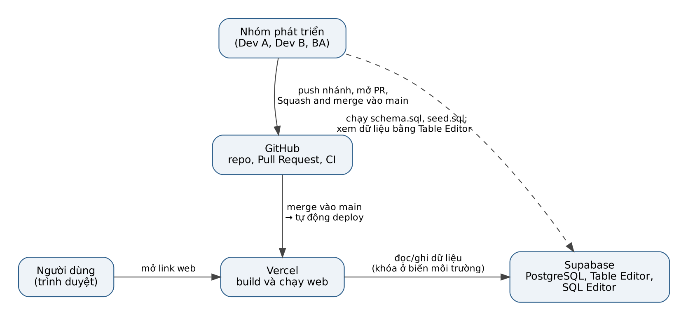
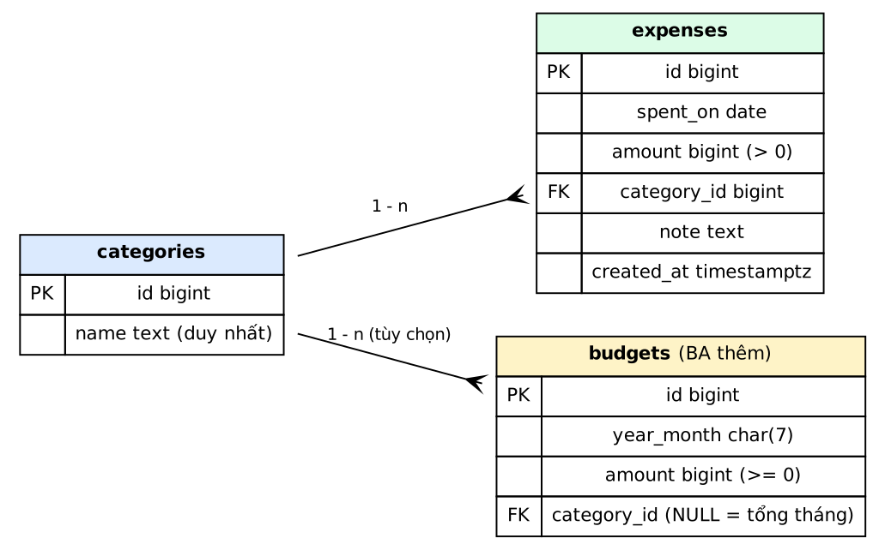

**Họ tên (BA kiêm test):** [điền họ tên] | **Mã sinh viên:** [điền] | **Lớp:** [điền] | **Giảng viên:** [điền]

**Thành viên:** Dev A (@yenhoang295), Dev B (@khuatdanhthai117-bit), BA kiêm test (@lethihuechi16-sen)

**Repo:** https://github.com/yenhoang295/nhom4-quan-ly-chi-tieu-ca-nhan

**Trang web:** [dán link Vercel của nhóm vào đây]

> Quy ước trong bản nháp này: nội dung trong ngoặc vuông `[...]` là chỗ BA phải điền hoặc chèn ảnh thật trước khi nộp.

# Chương 1. Giới thiệu

## 1.1 Mục tiêu
Xây dựng ứng dụng web giúp một cá nhân ghi chép khoản chi hằng ngày, phân loại theo danh mục, đặt ngân sách theo tháng và xem thống kê. Dự án là cơ hội thực hành quy trình làm việc nhóm hiện đại: phát triển hướng kiểm thử (TDD), quản lý mã nguồn bằng GitHub Flow, lưu dữ liệu trên PostgreSQL (Supabase) và đưa ứng dụng lên Internet bằng Vercel.

## 1.2 Phạm vi
Trong phạm vi: thêm, xem, lọc, sửa, xóa khoản chi; tạo và xóa danh mục; đặt ngân sách tháng và cảnh báo vượt ngân sách; thống kê chi theo tháng, danh mục chi nhiều nhất, so sánh hai tháng; lưu trữ trên Supabase; triển khai trên Vercel.

Ngoài phạm vi: ghi nhận khoản thu, kết nối ngân hàng, ứng dụng di động, đăng nhập cho người dùng cuối (chưa quyết định).

## 1.3 Phân công
| Vai trò | Thành viên | Nhiệm vụ |
|---|---|---|
| Dev A (trưởng nhóm) | @yenhoang295 | Khoản chi, cấu hình repo và CI, kết nối cơ sở dữ liệu |
| Dev B | @khuatdanhthai117-bit | Danh mục, ngân sách, thống kê |
| BA kiêm test | @lethihuechi16-sen | Yêu cầu, use case, thiết kế CSDL, test case, kiểm thử PR, coverage, README, báo cáo |

## 1.4 Yêu cầu chức năng
| Mã | Yêu cầu | Ưu tiên |
|---|---|---|
| FR-01 | Thêm khoản chi | Bắt buộc |
| FR-02 | Tính tổng chi (toàn bộ, theo tháng, theo danh mục) | Bắt buộc |
| FR-03 | Xem và lọc danh sách khoản chi | Bắt buộc |
| FR-04, FR-05 | Sửa, xóa khoản chi | Nên có |
| FR-06 | Tạo danh mục (không rỗng, không trùng) | Bắt buộc |
| FR-07 | Xóa danh mục (không xóa khi đang có khoản chi) | Nên có |
| FR-08 | Đặt ngân sách tháng (không âm) | Bắt buộc |
| FR-09 | Cảnh báo khi tổng chi vượt ngân sách | Bắt buộc |
| FR-10 | Thống kê tổng chi theo tháng | Bắt buộc |
| FR-11 | Danh mục chi nhiều nhất | Nên có |
| FR-12 | So sánh chi tiêu hai tháng | Nên có |
| FR-13 | Lưu dữ liệu trên Supabase (PostgreSQL) | Bắt buộc |
| FR-14 | Truy cập qua link công khai trên Vercel | Bắt buộc |

Chi tiết user story, use case và tiêu chí chấp nhận nằm trong `docs/ba/02` đến `docs/ba/05`.

## 1.5 Yêu cầu phi chức năng (tóm tắt)
Số tiền chính xác và lớn hơn 0; khoản chi luôn thuộc một danh mục có thật; bật Row Level Security; không đưa khóa và mật khẩu lên GitHub; mỗi chức năng có test tự động; coverage mã nghiệp vụ từ 80%; không push thẳng `main`; dự án Supabase đang chạy trước buổi demo.

# Chương 2. Cơ sở lý thuyết và công cụ

## 2.1 Phát triển hướng kiểm thử (TDD)
TDD là cách viết phần mềm trong đó kiểm thử được viết trước mã. Mỗi chức năng đi qua ba bước nhỏ, mỗi bước một commit riêng:

| Bước | Ý nghĩa | Loại commit |
|---|---|---|
| RED | Viết test mô tả hành vi mong muốn; chạy thì thất bại vì chưa có mã | `test` |
| GREEN | Viết lượng mã tối thiểu để test chạy qua | `feat` hoặc `fix` |
| REFACTOR | Dọn mã cho gọn, chạy lại vẫn xanh | `refactor` |

Minh chứng từ lịch sử commit của nhóm (nhánh `feature/2-danh-muc`, Dev B):

| Chức năng | RED | GREEN | REFACTOR |
|---|---|---|---|
| Thống kê chi theo tháng | `550fd7b` (03/10) | `e633b6b` (05/10) | |
| Danh mục chi nhiều nhất | `96f2c0e` (05/10) | `3966eba` (05/10) | |
| So sánh chi tiêu hai tháng | `aa77dc2` (06/10) | `4d9a0c7` (06/10) | |
| Các trường hợp biên, dọn mã | | `0c2e3ed` (07/10) | `ff0e288` (07/10) |

Nhận xét của BA: nhóm đã tách RED và GREEN thành commit riêng. Thông điệp commit của nhánh này đang viết không dấu, trong khi `CONTRIBUTING.md` yêu cầu tiếng Việt có dấu; nên thống nhất lại.

## 2.2 Kiểm thử đơn vị và đo độ phủ
Kiểm thử đơn vị kiểm tra từng hàm nhỏ một cách độc lập. Độ phủ (coverage) cho biết bao nhiêu phần trăm dòng mã được test chạy qua. Cấu hình hiện tại trong `pom.xml`: JUnit 5 (bản 5.14.0) để viết test và JaCoCo (bản 0.8.15) để đo coverage, chạy bằng `mvn verify`; báo cáo nằm ở `target/site/jacoco/index.html`. Mục tiêu của nhóm là từ 80%.

[Phần này cần cập nhật nếu nhóm đổi ngôn ngữ lập trình: công cụ tương ứng ví dụ `pytest` và `coverage.py` cho Python.]

## 2.3 PostgreSQL và Supabase
PostgreSQL là hệ quản trị cơ sở dữ liệu quan hệ mã nguồn mở. Supabase cung cấp PostgreSQL dưới dạng dịch vụ có giao diện web: SQL Editor để chạy lệnh, Table Editor để xem và sửa dữ liệu như bảng tính, và các khóa API để ứng dụng truy cập. Gói miễn phí có 500 MB mỗi dự án và tạm dừng dự án sau một tuần không hoạt động.

## 2.4 Vercel
Vercel tự động build mã từ GitHub và chạy thành trang web có link công khai. Mỗi lần merge vào `main`, Vercel cập nhật trang chính. Các giá trị nhạy cảm như khóa API được đặt trong biến môi trường của Vercel, không nằm trong mã.

## 2.5 GitHub và GitHub Actions
GitHub lưu mã nguồn, quản lý Issue và Pull Request. GitHub Actions chạy quy trình kiểm thử tự động (job `build`) trên mỗi Pull Request. Supabase và Vercel đều được liên kết bằng tài khoản GitHub (đăng nhập bằng GitHub).

# Chương 3. Quy trình làm việc GitHub Flow

## 3.1 Quy ước
| Nội dung | Quy ước |
|---|---|
| Nhánh | `loai/so-issue-mo-ta`, chữ thường, không dấu, ví dụ `docs/5-nhat-ky-ba`, `feature/2-danh-muc` |
| Commit | `<type>(<scope>): <mô tả>`, tiếng Việt có dấu, mỗi commit một việc |
| Pull Request | Tiêu đề theo quy ước commit, có `Closes #số-issue`, dưới khoảng 400 dòng, CI xanh mới nhờ duyệt |
| Duyệt | Có 1 Approve thì tác giả tự bấm Squash and merge rồi xóa nhánh |
| Cấm | Push thẳng `main`; commit mật khẩu, `.env`, thư mục `target/` |

## 3.2 Công cụ bảo vệ nhánh `main`
- **CODEOWNERS:** vùng của Dev A do Dev B duyệt và ngược lại; `docs/ba/` và `db/` do cả hai dev duyệt.
- **Mẫu Pull Request:** có sẵn mục "Mô tả thay đổi", `Closes #`, và ba ô kiểm: `mvn verify` xanh, đã viết test trước, BA đã test.
- **CI:** job `build` chạy trên mỗi Pull Request vào `main`.
- **Ruleset `bao-ve-main`:** yêu cầu Pull Request, có review và job `build` phải xanh.

[Chèn ảnh trang Settings → Rulesets → bao-ve-main: `images/github-rulesets.png`]

[Chèn ảnh một Pull Request đã được Approve và merge: `images/github-pr-co-review.png`]

## 3.3 Các Pull Request tiêu biểu
| PR | Nội dung | Tác giả |
|---|---|---|
| #1 | Cấu hình CODEOWNERS, CI và khung dự án Maven | Dev A |
| #8 | Chuyển nhật ký BA vào thư mục `docs` | BA |
| #9 | Chức năng danh mục (feature/2-danh-muc) | Dev B |
| #12 | Cập nhật nhật ký BA ngày 01 và 02/10 | BA |
| #14 | Nhật ký cá nhân của Dev A | Dev A |

# Chương 4. Thiết kế cơ sở dữ liệu và hạ tầng

## 4.1 Sơ đồ quan hệ
Cơ sở dữ liệu PostgreSQL có ba bảng: `categories` (danh mục), `expenses` (khoản chi), `budgets` (ngân sách tháng). Hai bảng đầu trùng với `supabase/schema.sql` của Dev A; bảng `budgets` do BA thêm.

## 4.2 Từ điển dữ liệu
| Bảng | Cột | Kiểu | Ràng buộc |
|---|---|---|---|
| categories | id | bigint (identity) | Khóa chính |
| categories | name | text | Không rỗng, duy nhất không phân biệt hoa/thường |
| expenses | id | bigint (identity) | Khóa chính |
| expenses | spent_on | date | Bắt buộc |
| expenses | amount | bigint | Lớn hơn 0 |
| expenses | category_id | bigint | Khóa ngoại → categories, không cho xóa danh mục đang dùng |
| expenses | note |
| expenses | created_at | timestamptz | Mặc định thời điểm tạo | text | Có thể rỗng |
| budgets | id | bigint (identity) | Khóa chính |
| budgets | year_month | char(7) | Dạng yyyy-MM, tháng 01 đến 12 |
| budgets | amount | bigint | Từ 0 trở lên |
| budgets | category_id | bigint | Khóa ngoại → categories; rỗng nghĩa là ngân sách tổng tháng |

Mỗi (tháng, danh mục) chỉ có một ngân sách; mỗi tháng chỉ có một ngân sách tổng.

## 4.3 Bảo mật mức dòng (RLS)
Cả ba bảng bật Row Level Security. Bản demo của nhóm cho khóa công khai đọc, thêm và xóa khoản chi, đọc và thêm danh mục, nhưng không sửa và không xóa danh mục. Rủi ro đã biết: ai có khóa công khai trong mã web đều thêm và xóa được khoản chi. Hướng khắc phục: thêm Supabase Auth rồi giới hạn policy cho người đã đăng nhập.

## 4.4 Minh chứng trên Supabase
[Chèn ảnh SQL Editor sau khi chạy schema.sql: `images/supabase-sql-editor-schema.png`]

[Chèn ảnh Table Editor bảng expense có dữ liệu mẫu: `images/supabase-table-editor-expense.png`]

[Chèn ảnh Table Editor bảng category: `images/supabase-table-editor-category.png`]

[Chèn ảnh Table Editor bảng budget: `images/supabase-table-editor-budget.png`]

## 4.5 Minh chứng trên Vercel
Link trang web: [dán link Vercel].

[Chèn ảnh trang web đang chạy: `images/vercel-trang-web.png`]

[Chèn ảnh tab Deployments: `images/vercel-deployments.png`]

# Chương 5. Kiểm thử

## 5.1 Chiến lược
Kiểm thử gồm ba lớp: (1) test đơn vị do Dev viết theo TDD, chạy trong CI; (2) test cơ sở dữ liệu do BA viết bằng SQL, chạy trong Supabase SQL Editor; (3) test mức ứng dụng do BA thực hiện thủ công theo tiêu chí chấp nhận. Mỗi Pull Request của Dev đều được BA kiểm tra và ghi kết quả vào PR bằng bình luận "Đã test OK" hoặc mô tả lỗi.

## 5.2 Bộ test case
`docs/ba/test-cases.md` gồm 66 test case: 23 test cơ sở dữ liệu (TC-DB), 5 test đơn vị Java của Dev A (TC-JAVA, đã có trên `main`) và 38 test mức ứng dụng (TC-APP), sinh từ các tiêu chí chấp nhận Given/When/Then. Dữ liệu mẫu trong `db/seed.sql` (chạy trên dự án trống) có tổng chi tháng 9/2026 là 1.615.000 đồng và tháng 10/2026 là 2.850.000 đồng, danh mục chi nhiều nhất lần lượt là Mua sắm (400.000) và Ăn uống (920.000).

## 5.3 Kết quả kiểm thử cơ sở dữ liệu
Hai file `schema.sql` và `seed.sql` đã được chạy thử (kể cả khi bảng của Dev A đã có sẵn) trên PostgreSQL 16 cục bộ, mỗi file hai lần liên tiếp mà không lỗi và không nhân đôi dữ liệu. Cả 23 test TC-DB cho kết quả đúng mong đợi, gồm: từ chối số tiền không dương, danh mục không tồn tại, danh mục trùng, ngân sách sai định dạng hoặc trùng, không xóa được danh mục đang dùng, khóa `anon` không xóa được danh mục.

[BA chạy lại 23 test trên Supabase thật và chèn bảng kết quả hoặc ảnh chụp.]

## 5.4 Lỗi phát hiện khi kiểm thử Pull Request
| Mã | Mô tả | Mức độ | Trạng thái |
|---|---|---|---|
| BUG-01 | Tệp `test_budget.py` lỗi thụt lề (IndentationError ở dòng 14) trên cả `main` (PR #9) và nhánh `feature/2-danh-muc`, nên test không chạy được | Cao | [điền: Mở/Đã sửa, số Issue] |
| BUG-02 | Mã `budget` viết bằng Python ở thư mục gốc, trong khi khung dự án và CI là Java/Maven (`mvn verify`); CI không kiểm thử và JaCoCo không đo được mã này | Cao | [điền] |

## 5.5 Kết quả kiểm thử thủ công mức ứng dụng
[BA điền bảng: mã TC, kết quả thực tế, Đạt hoặc Lỗi, lấy từ mục 3 của `test-cases.md` sau khi web chạy được.]

# Chương 6. Độ phủ kiểm thử (coverage)

Mục tiêu: từ 80% đối với mã nghiệp vụ. Tại thời điểm 09/10/2026, thư mục `src` mới có một test khởi tạo (`KhoiTaoDuAnTest`) và chưa có mã nghiệp vụ Java, nên chưa có số liệu coverage có ý nghĩa.

| Lần đo | Ngày | Lệnh | Coverage | Ảnh |
|---|---|---|---|---|
| 1 | [điền] | `mvn verify` | [điền]% | [chèn ảnh `images/coverage-lan-1.png`] |
| Cuối | [điền] | `mvn verify` | [điền]% | [chèn ảnh `images/coverage-cuoi.png`] |

Danh sách class và dòng chưa được test (gửi Dev A, Dev B ở ngày 10): [điền].

# Chương 7. Kết luận

## 7.1 Kết quả đạt được
[BA điền sau khi nhóm hoàn thành: các chức năng đã chạy, link web, số PR đã merge, coverage cuối.]

## 7.2 Hạn chế
- Ngôn ngữ lập trình của web chưa thống nhất giữa khung Maven (Java) và mã Python hiện có; Vercel không chạy Java trực tiếp.
- Gói miễn phí của Supabase tạm dừng dự án sau một tuần không hoạt động.
- Chưa có đăng nhập cho người dùng cuối.

## 7.3 Hướng phát triển
Thêm đăng nhập bằng Supabase Auth và tách dữ liệu theo từng người dùng; thêm khoản thu và số dư; biểu đồ thống kê.

## 7.4 Việc sử dụng công cụ AI
Xem tệp `AI_USAGE.md` ở thư mục gốc của repo.

# Tài liệu tham khảo
1. Supabase, bảng giá và giới hạn gói miễn phí: https://supabase.com/pricing
2. Vercel, danh sách runtime của Functions: https://vercel.com/docs/functions/runtimes
3. PostgreSQL Documentation: https://www.postgresql.org/docs/
4. GitHub Docs, GitHub Flow: https://docs.github.com/en/get-started/using-github/github-flow
